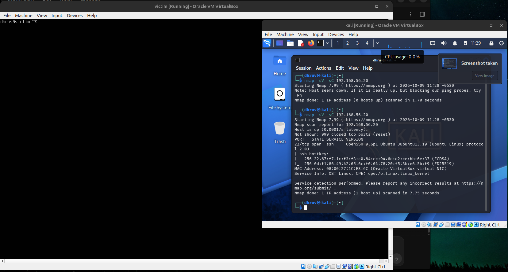
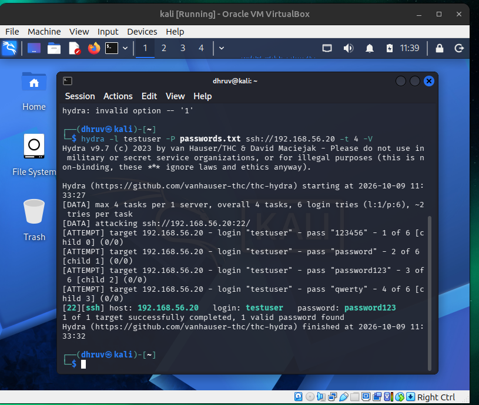
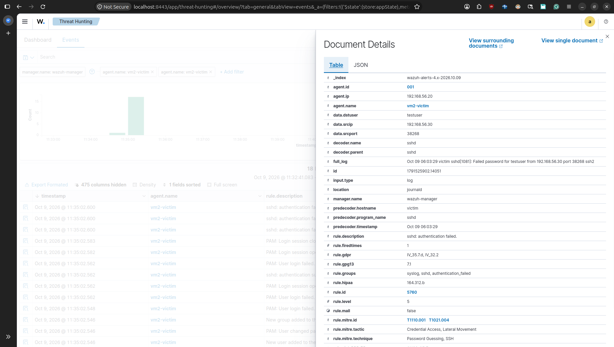
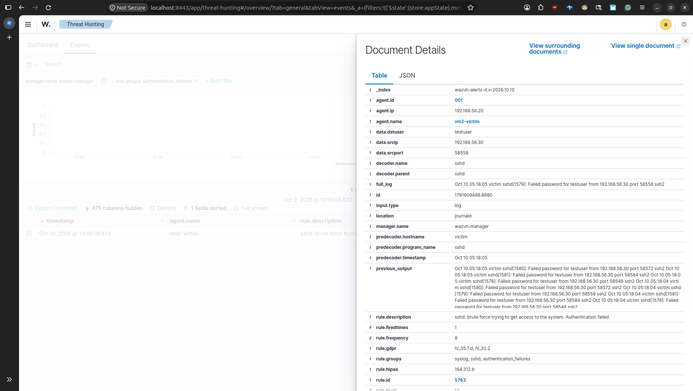
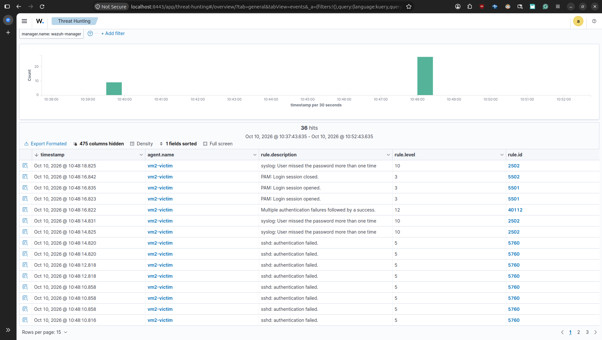
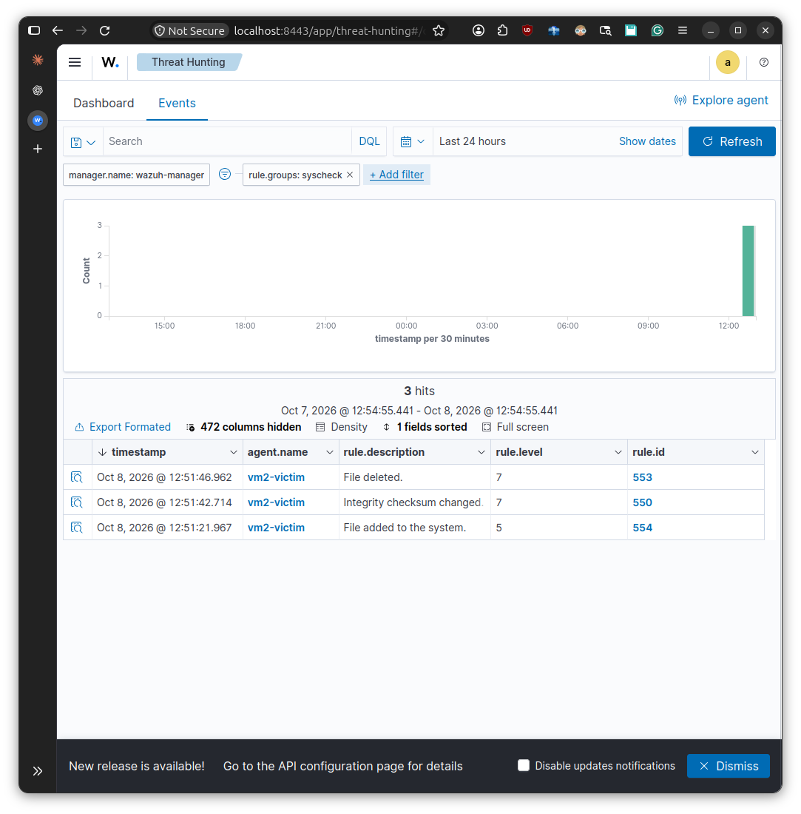
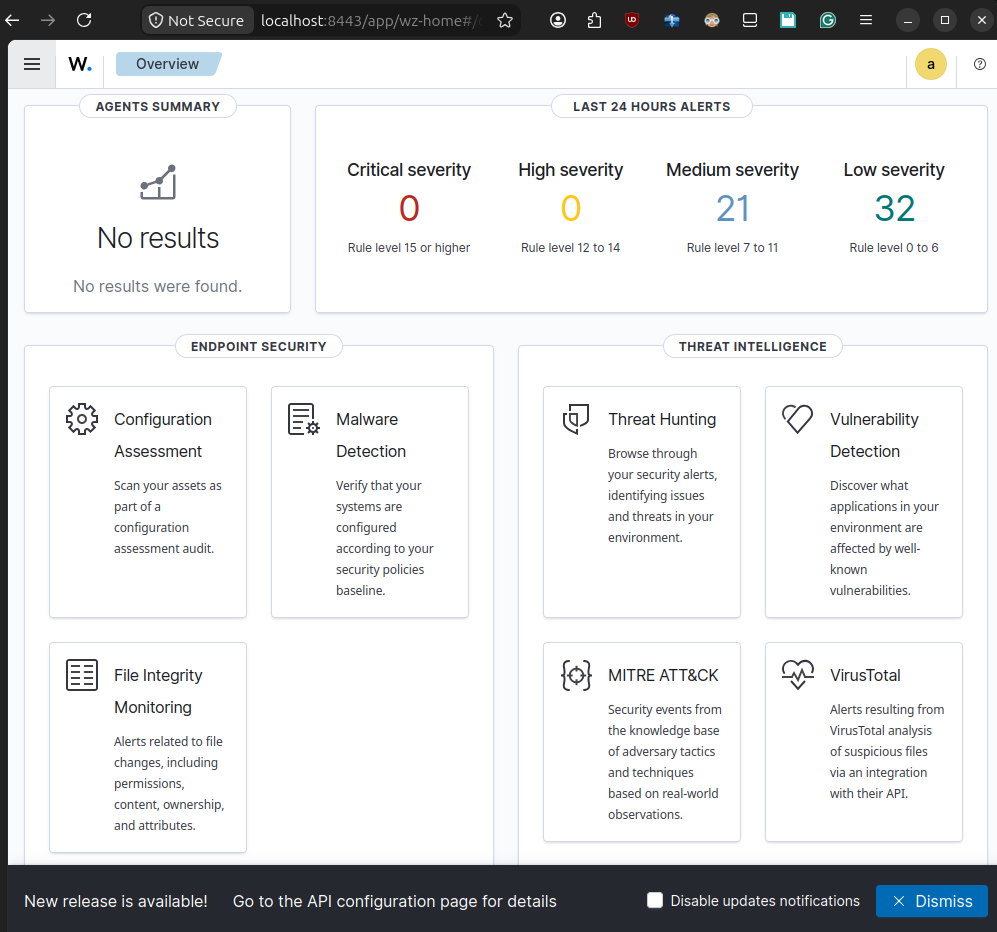

# Attack & Detection Walkthrough

## 1. Recon
`nmap -sV -sC 192.168.56.20` from VM3 identifies open SSH (22) on the victim,
with OpenSSH 9.6p1 banner captured.

## 2. Attack
A deliberately weak test account (`testuser`) was created on VM2 for this
demo. `hydra` brute-forced it from VM3 and recovered the password:
hydra -l testuser -P passwords.txt ssh://192.168.56.20 -t 1 -V

## 3. Raw detection
Wazuh logged each failed login individually. Expanded event shows rule 5760
("sshd: authentication failed", level 5) with the source IP (192.168.56.30)
and destination user (testuser) captured.

## 4. Correlated detection
Wazuh's brute-force correlation rule (5763, level 10) fired after repeated
failures from the same source IP within its 120-second window. The expanded
alert includes `previous_output`, showing the burst of failed attempts that
triggered the correlation.

A second, higher-severity correlation rule (40112, level 12 — "Multiple
authentication failures followed by a success") also fired, since the attack
included a successful login immediately after the failure burst.

## 5. File Integrity Monitoring
Configured real-time FIM on `/srv/fimtest`. All three lifecycle events were
captured as separate alerts: file added (rule 554), integrity checksum
changed (rule 550), and file deleted (rule 553).

## 6. Dashboard overview
Wazuh's overview page summarizing alert severity distribution (0 critical,
0 high, 21 medium, 32 low in the last 24 hours) and available endpoint
security / threat intelligence modules.

